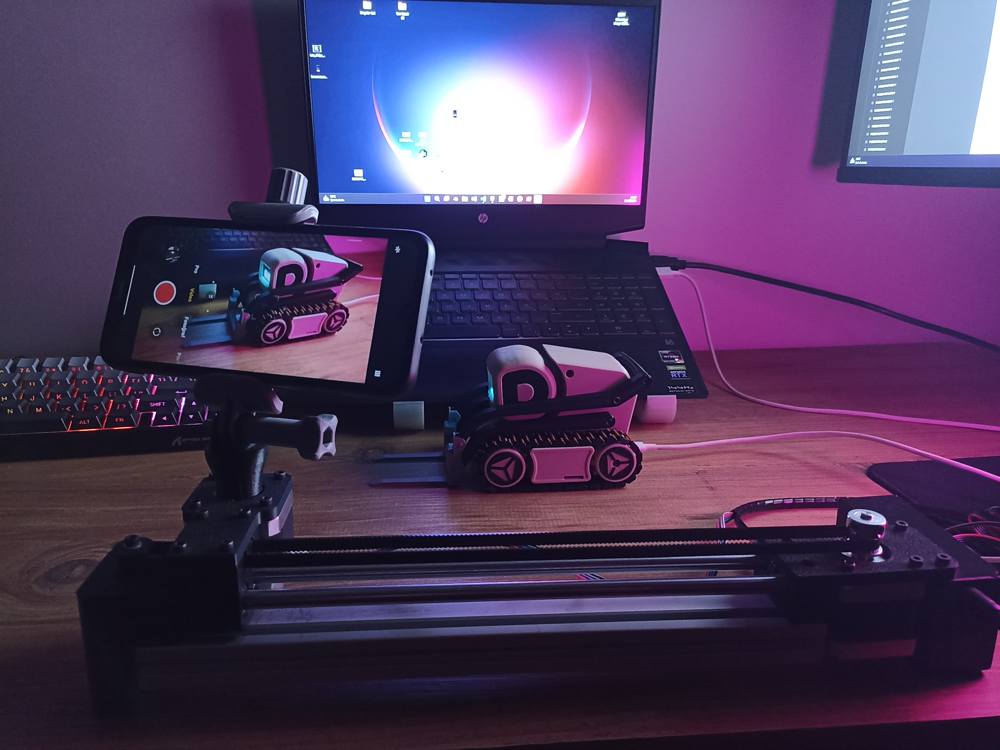
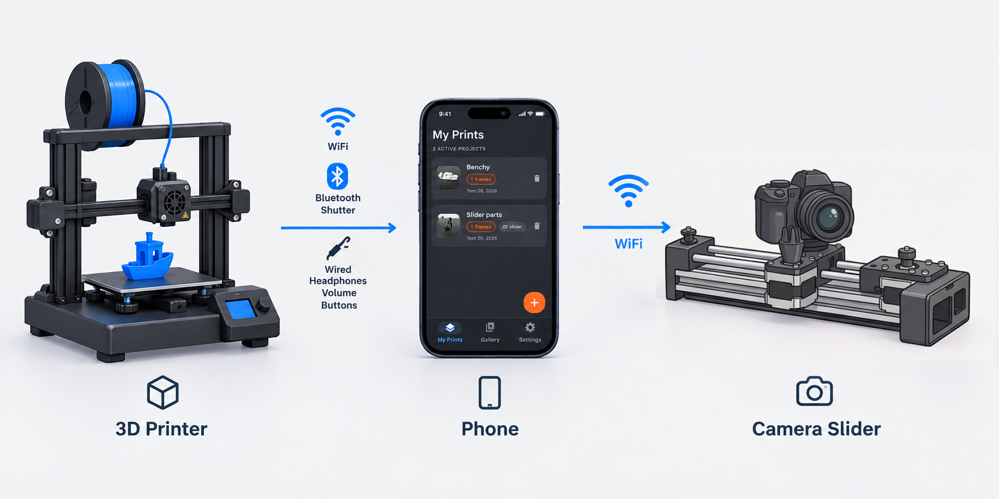
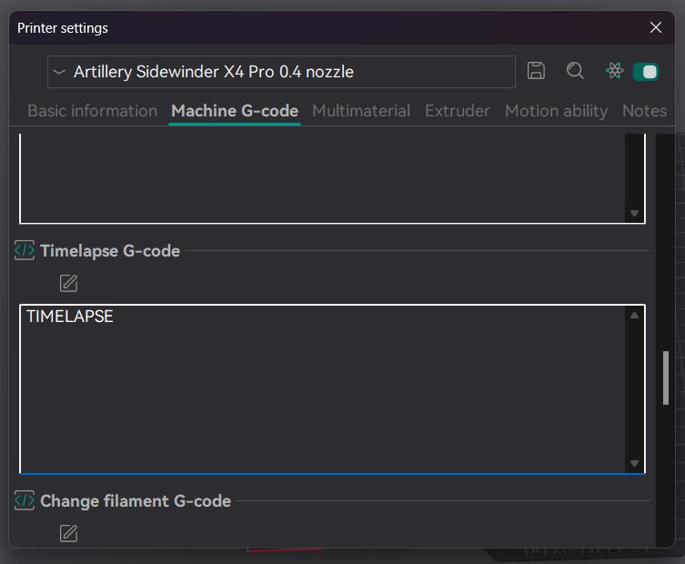
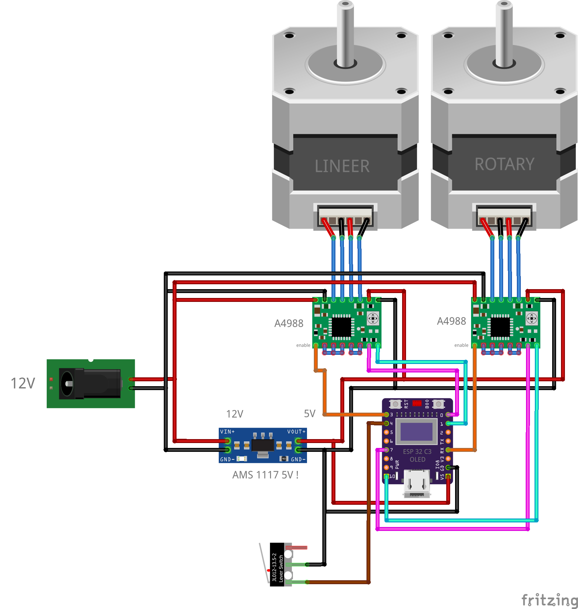

# Camera Slider

**English** | [Türkçe](README.tr.md)



A 2-axis motorized camera slider based on the ESP32-C3, controlled over Wi-Fi.
The linear axis carries the camera along a GT2 belt-driven rail, while the rotary
(pan) axis turns the platform on the rail through 360°. Everything is controlled
from a web interface that runs in your phone or computer browser — no app to install.

## Features

- **2 axes:** linear slider (NEMA 17 + GT2 belt) and a 360° pan platform (NEMA 17, direct drive)
- **Web interface:** served from LittleFS on the device; live status and control over WebSocket
- **Wi-Fi:** joins your home network (`camera-slider.local`); if it can't, it opens its own hotspot
  (SSID `CameraSlider`, the setup page opens automatically via a captive portal)
- **Automatic motion:** back-and-forth travel between start/end points at an adjustable speed,
  with both axes running in sync on a shared clock
- **Homing:** linear axis homing with a limit switch (fast approach → back off → slow re-approach)
- **Jog:** drive the slider by hand from the web interface, with adjustable speed
- **OLED:** the board's 0.42" display shows the IP address; on boot, a Wi-Fi attempt counter;
  in hotspot mode, the network name and password
- Hardware-assisted step generation with [FastAccelStepper](https://github.com/gin66/FastAccelStepper)

## First use

1. Power the device. If no network is saved, it opens a hotspot named **`CameraSlider`**
   (password `12345678`).
2. Connect your phone to this network. The setup page opens on its own; if it doesn't,
   type **`http://192.168.4.1`** into your browser (the leading `http://` matters).
3. Pick your home network from the list and enter its password. The device reconnects.
4. From then on, the control interface is at **`http://camera-slider.local`** —
   the IP address is also shown on the board's OLED display.

## Interface


## Making 3D Printer Timelapse Videos with PrintLapse

The slider can be used together with the
**[PrintLapse](https://play.google.com/store/apps/details?id=com.printlapse)**
Android app to shoot timelapse videos of 3D prints. One photo is taken per layer,
and the camera slowly travels from the start point to the end point over the course
of the print, adding motion to the video.

📱 **Get the app:** [PrintLapse — Google Play](https://play.google.com/store/apps/details?id=com.printlapse)

When used with PrintLapse, the flow is as shown in the diagram:



1. **Printer → phone:** On every layer change, the printer sends a trigger to the phone.
2. **Phone:** PrintLapse receives the trigger and takes a photo.
3. **Phone → slider:** After the photo is taken, PrintLapse sends the next layer number
   to the slider over Wi-Fi. The slider moves both axes to the position for that layer.
   The slider does not move while a photo is being taken.

Positions are spread evenly between start and end: the first layer lands on the
start point and the last layer on the end point.

### Trigger options

On every layer change, the printer moves the head to a fixed park position and
triggers the photo in one of three ways:

| Trigger | How it works |
|---|---|
| **Wi-Fi** | The printer sends a `http://<phone-IP-address>:5000/foto-cek` request to the phone. **Settings → Network Trigger** must be enabled in the app. |
| **Switch (shutter)** | The head moves a little further right past the park position and presses a switch mounted on the printer. The contacts of a **Bluetooth shutter remote** or the **volume button of a wired headset** are soldered to the switch terminals; the phone sees it as a volume button press. No network connection needed. The print files for the switch box are in the [`3d-models/shutter/`](3d-models/shutter/) folder. |
| **Visual trigger** | PrintLapse uses image processing on the camera feed to track the printer's head or another moving part. You mark an area on the image; when the tracked part enters that area, a photo is taken. No network connection or extra hardware needed. |

Photos of the switch box mounted on the printer and of its wiring are in the
same folder:
[top](3d-models/shutter/kurulum-ustten.jpg) ·
[side](3d-models/shutter/kurulum-yandan.jpg) ·
[parts and wiring](3d-models/shutter/parcalar.jpg).

> **Note:** The switch box was designed for the **Artillery Sidewinder X4 Pro**; it
> may not fit other printers. You can search online for a similar switch/shutter
> holder for your own printer.

### Klipper macro

Add the macros below to your `printer.cfg`. Triggering over Wi-Fi requires the
**G-Code Shell Command** extension to be installed in Klipper
(it can be installed from the Extensions menu of [KIAUH](https://github.com/dw-0/kiauh)).

```ini
[gcode_macro TIMELAPSE_ON]
description: Enable timelapse
gcode:
  SET_GCODE_VARIABLE MACRO=TIMELAPSE VARIABLE=enabled VALUE=1
  M117 Timelapse ON

[gcode_macro TIMELAPSE_OFF]
description: Disable timelapse
gcode:
  SET_GCODE_VARIABLE MACRO=TIMELAPSE VARIABLE=enabled VALUE=0
  M117 Timelapse OFF

[gcode_macro TIMELAPSE]
variable_enabled: 0
gcode:
  
    
    
    
    

    G91
    G1 E-{retract} F2100            ; retract filament
    G1 Z{z_hop} F600                ; lift the nozzle off the print
    G90
    G1 X{park_x} Y{park_y} F7000    ; move to the park position
    M400
    G4 P300                         ; let vibrations settle
    RUN_SHELL_COMMAND CMD=trigger_camera
    G4 P1500                        ; wait for the photo
    G91
    G1 Z-{z_hop} F600
    M83
    G1 E{retract} F2100
    G90
  

[gcode_shell_command trigger_camera]
command: curl http://<PHONE_IP_ADDRESS>:5000/foto-cek
timeout: 6.
verbose: False
```

**To trigger with the switch**, replace the `RUN_SHELL_COMMAND CMD=trigger_camera`
line in the macro with a move that takes the head to the switch and back. The
distance depends on where the switch is mounted and varies from printer to printer:

```ini
    G1 X{park_x + 8} F3000          ; press the switch (adjust the distance for your printer)
    G4 P200
    G1 X{park_x} F3000              ; move back
```

Before using it:

- Add a `TIMELAPSE` line to the G-code field in your slicer that runs on every layer
  change. In OrcaSlicer this field is under **Printer settings → Machine G-code →
  Timelapse G-code**:

  

- The macro is disabled by default: run `TIMELAPSE_ON` before printing
  (or add it to your `PRINT_START` macro).
- You can change the park position for your printer: `TIMELAPSE X=230 Y=230`.

### Using PrintLapse

1. **Prepare the slider.** Complete the homing steps in the web interface, drive the
   slider to the positions you want, and save the start and end points with the
   **Use as Start** and **Use as End** buttons.
2. **Enter the slider's address.** In PrintLapse, type the IP address shown on the
   slider's OLED display into **Settings → Slider IP Address** and tap
   **Test Connection**. The phone and the slider must be on the same Wi-Fi network.
3. **Set up the trigger.** Add the [Klipper macro](#klipper-macro) to your printer.
   If you trigger over Wi-Fi, enable **Settings → Network Trigger** in the app.
4. **Create the project.** Open a new project, enable **Use camera slider**, and enter
   the layer count shown in your slicer into the **Total Layers** field. Then tap
   **Start Camera**.
5. **Check.** The **SLIDER** card at the top of the camera screen shows the connection
   status, the slider position and the number of frames taken. **Go to Start** moves
   the slider to the start point; **Preview** does a test run from start to end.
   If the card shows an orange warning (e.g. "Homing required", "Start and end not
   set"), resolve it first.
6. **Start the print.** One frame is taken per trigger and the slider moves to the
   next position. The app lets you know when the total layer count is reached.

If you run into connection problems, see the [Troubleshooting](#troubleshooting) section.

## Hardware

| Part | Description |
|---|---|
| ESP32-C3 0.42" OLED SuperMini | Main controller (built-in SSD1306 72×40 OLED) |
| 2× A4988 | Stepper motor drivers (1/16 microstepping) |
| 2× NEMA 17 | 1.8°/step; one for the linear axis, one for pan |
| AMS1117 5V regulator module | 12V → 5V (ESP32 supply) |
| Lever limit switch (JL012-13.5-2) | Linear axis home position |
| 12V adapter + barrel jack | Motor supply |

### Mechanical / fastening parts

| Part | Qty | Note |
|---|---|---|
| 20 × 40 mm aluminium extrusion, 300 mm | 1 | Slider body |
| 8 mm diameter, 300 mm linear rod | 2 | Carriage rails |
| LM8UU linear bearing | 2 | For the 8 mm rods |
| M3 × 10 mm bolt | 17 | General assembly |
| M3 × 25 mm bolt | 2 | — |
| M3 nut | 4 | — |
| M3 heat-set insert | 7 | Pressed into the 3D printed parts |
| M5 × 25 mm bolt | 1 | Phone holder mount |
| M5 nut | 1 | Phone holder mount |
| 30 × 70 mm perfboard | 1 | Driver/wiring board |

## Wiring diagram



High-resolution PDF: [docs/baglanti-semasi.pdf](docs/baglanti-semasi.pdf)

### Pin map

| ESP32-C3 pin | Connects to | Note |
|---|---|---|
| GPIO0 | A4988 #1 — STEP | Linear axis step signal |
| GPIO1 | A4988 #1 — DIR | Linear axis direction |
| GPIO3 | A4988 #1 — ENABLE | Active LOW (LOW = driver enabled) |
| GPIO4 | Limit switch → GND | `INPUT_PULLUP`; LOW when pressed |
| GPIO7 | A4988 #2 — STEP | Pan axis step signal |
| GPIO10 | A4988 #2 — DIR | Pan axis direction |
| GPIO20 | A4988 #2 — ENABLE | UART0-TX pin; free because Serial runs over USB-CDC |
| GPIO21 | Pan limit switch (reserved) | Not connected, `PAN_HAS_LIMIT=0` |
| GPIO5 / GPIO6 | Built-in OLED SDA / SCL | Fixed on the board; I²C `0x3C` |
| 5V | AMS1117 output | ESP32 supply (not needed while USB is plugged in) |
| 3V3 | Both A4988 — VDD | Driver logic supply |
| GND | Common ground | ESP + drivers + 12V supply + limit switch |

**A4988 setup:** RESET ↔ SLEEP bridged; MS1 = MS2 = MS3 = HIGH → 1/16 microstepping
(must match `DRIVER_MICROSTEP 16` in the code); a 100 µF capacitor across VMOT–GND
of each driver. The current limit is set with the Vref potentiometer.

**Pins to avoid:** GPIO2, GPIO8, GPIO9 (strapping/BOOT), GPIO18/19 (USB D−/D+), GPIO11–17 (flash).

## Assembly


### 3D printed parts

STL files for all parts that need to be printed are in the
[`3d-models/`](3d-models/) folder:

```
3d-models/
├── slider/           Project-specific parts (motor mounts, carriage, belt holder, etc.)
├── shutter/          Switch box pressed by the printer head (PrintLapse trigger)
└── telefon-tutucu/   Phone holder modules (third-party design — see below)
```

See [`3d-models/README.md`](3d-models/README.md) for recommended print settings and
the parts list.

#### Phone holder — attribution

The models in `3d-models/telefon-tutucu/` are not mine: they come from the
**Modular Mounting System** project designed by
[HeyVye](https://www.thingiverse.com/thing:2194278), licensed under Creative Commons
Attribution (CC BY). I included them in the repo so users don't have to look for them
separately. Follow the instructions on the original page to assemble this part — the
modules join with M5 bolts/nuts, and the mount is GoPro-compatible.

## Mechanical / calibration defaults

- Linear: 200 steps/rev × 16 microsteps = 3200 steps/rev; GT2 20T pulley (40 mm/rev) → **80 steps/mm**
- Pan: direct drive, 3200 steps = 360°
- Max. travel 300 mm, max. speed 50 mm/s — all can be changed from the web interface and are stored persistently

## Building and uploading

The project is built with [PlatformIO](https://platformio.org/):

```
pio run -t upload          # firmware
pio run -t uploadfs        # web interface (data/ → LittleFS)
```

After uploading both, the device opens its hotspot on boot — see
[First use](#first-use) for what comes next.

## Troubleshooting

### If the slider isn't working as expected: check the Wi-Fi distance first

Most problems — frequently seeing **"Not connected"** in the app, delayed commands,
the slider not moving between frames, or failing to join the home network on boot
and falling back to hotspot mode — are caused by **the slider being too far from
the router.**

The ESP32-C3 SuperMini board uses a small **SMD (ceramic) antenna** soldered onto
the board. Both its transmit and receive performance are noticeably weaker than
ESP32 models with an external antenna connector or a larger PCB antenna. A network
your phone connects to comfortably from the same spot may be borderline for the slider.

What you can do (largest effect first):

- **Move the slider closer to the router**, or reduce the number of walls in between.
  Use it in the same room as the router if possible; if not, add a Wi-Fi extender / mesh node.
- **Keep the area around the antenna clear.** There should be no metal within
  1–1.5 cm of the antenna: aluminium extrusion, motor cables and wire bundles "kill"
  the antenna (20 dB of loss is common). Inside an enclosure, make sure the antenna
  faces a plastic wall rather than metal parts.
- **Twist motor cables** in pairs and route them away from the antenna.
- **Strengthen the power supply.** The board draws high current bursts while
  transmitting over Wi-Fi; if the 3.3 V rail sags, the signal degrades. Place a
  470–1000 µF + 100 nF capacitor right next to the ESP board, add 100 µF close to
  each A4988's VMOT input, and make sure the motor ground does not return through
  the ESP's ground.

**To measure signal strength**, connect the board to a computer over USB and open
the serial monitor (`pio device monitor`, 115200 baud). When the board joins the
network it prints a line like this:

```
[wifi] connected to MyHomeWiFi  RSSI -58 dBm  IP 192.168.1.110
```

| RSSI | Meaning |
|---|---|
| -30 … -60 dBm | Good |
| -60 … -70 dBm | Usable, occasional drops possible |
| Worse than -70 dBm | Weak — expect drops and failure to connect on boot |

With a weak signal you will also see `[wifi] attempt 2 failed: AUTH_FAIL` or
`[wifi] link lost` lines in the serial monitor. The ESP32 can report `AUTH_FAIL`
on a weak signal even when the password is correct.

### Can't join the home network on boot

- On boot the OLED shows **"Connecting"** with a large **attempt number** below it.
  The board keeps retrying the saved network for about 22 seconds.
- If it can't connect, it switches to hotspot mode and the OLED shows **"AP MODE"**,
  the network name (`CameraSlider`) and the password (`12345678`).
- While no one is connected to the hotspot, the board quietly retries the home
  network once a minute. If the router came up late or the first attempt was
  unlucky, it connects on its own **without pressing reset**.
- If it falls back to "AP MODE" every time, either the password is wrong (connect to
  the hotspot and enter it again) or the signal is weak (see the section above).

### The setup page doesn't open on its own

- Type **`http://192.168.4.1`** into your browser (the leading `http://` matters).
- Some phones drop this network because it has no internet access and switch back to
  mobile data. Confirm the phone's "stay on this network / stay connected" prompt, or
  turn off mobile data during setup.

### The app says "Start and end not set"

No start/end point has been saved on the slider yet. In the web interface, drive the
slider to the position you want and press the **Use as Start** and **Use as End**
buttons. A button that hasn't been saved yet is shown in orange. If you are using a
browser tab opened before a firmware update, reload the page first.

## Project structure

```
src/            Firmware source code (Config.h: all pins and default settings)
data/           Web interface (uploaded to LittleFS)
docs/           Wiring diagram (PNG + PDF, Fritzing drawing)
3d-models/      STL files for the printed parts
platformio.ini  Build configuration
```

## License

The source code and design files of this project are licensed under the MIT
License — see [LICENSE](LICENSE). The `3d-models/telefon-tutucu/` folder is an
exception; those parts belong to a third party and are distributed under CC BY
(see the attribution above).

## Acknowledgements

- Phone holder modules: **Modular Mounting System** — [HeyVye](https://www.thingiverse.com/thing:2194278) (CC BY)
- Step generation: [FastAccelStepper](https://github.com/gin66/FastAccelStepper) — gin66
